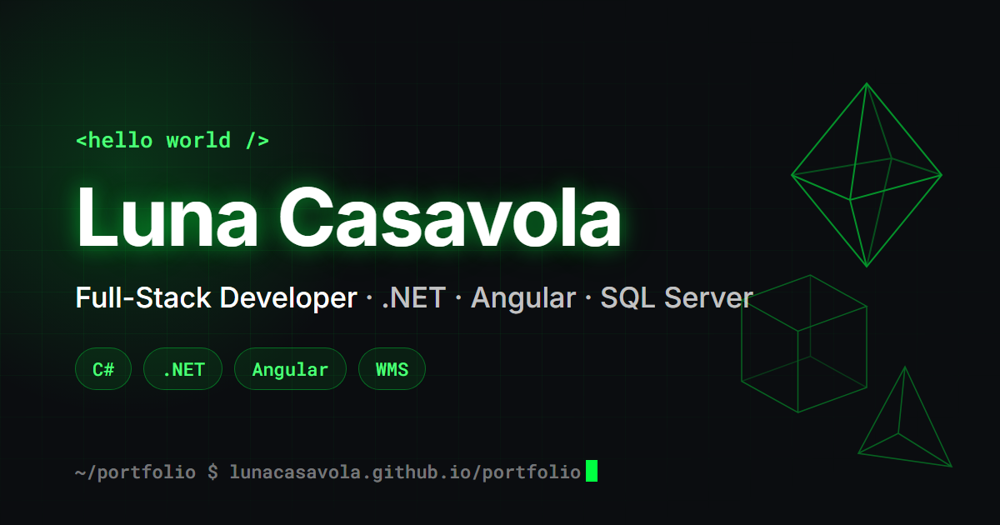
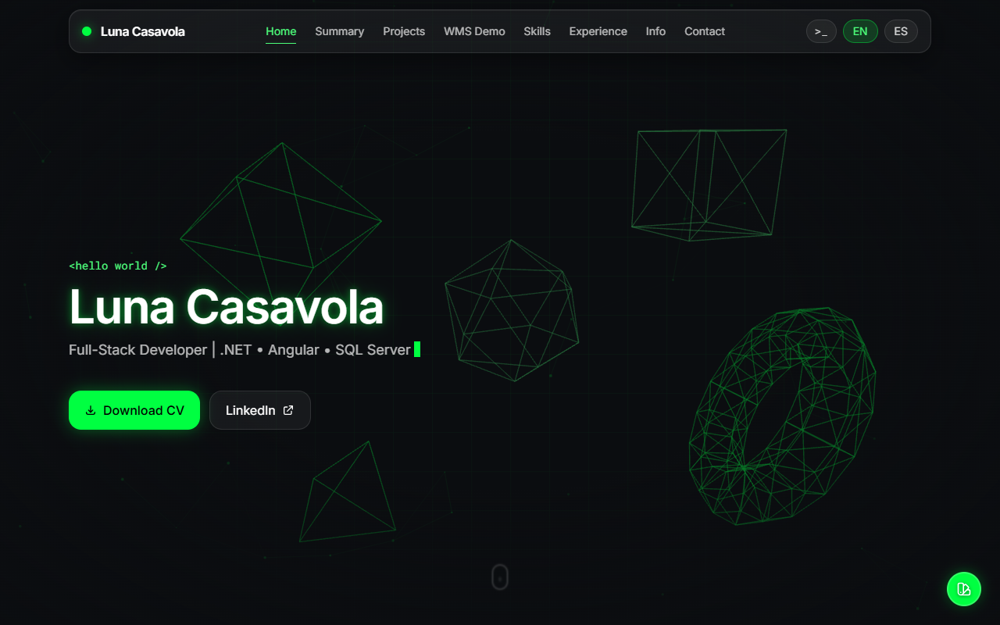

<div align="center">



# Luna Casavola · Portfolio

**Full-Stack Developer** · .NET · Angular · SQL Server · WMS & warehouse automation

[**🌐 Live site**](https://lunacasavola.github.io/portfolio/) · [LinkedIn](https://www.linkedin.com/in/lunacasavola) · [Download CV](src/assets/Luna-Casavola-CV.pdf)


</div>

---



## ✨ Highlights

### 🏭 Playable WMS demo
I build warehouse management software for a living, so instead of describing it, the portfolio lets you **run a warehouse order yourself**:

1. **Release an order** to the floor from a handheld-style screen.
2. **Pick it** from a 12-bin **pick-to-light** rack: lit bins show how many units are left, wrong bins flash red.
3. Watch the carton ride the **conveyor**, get **scanned** and **diverted by the sorter** to its route lane.
4. Get a **shipping label** printed with your name, next to the real **ZPL** code a Zebra printer would receive.

An event log mirrors what a real WMS records (`PTL A-02-3 ON qty=2`, `SORTER DIVERT → LANE 3`…).

### 💻 Interactive terminal
Press <kbd>Ctrl</kbd>+<kbd>K</kbd> or <kbd>`</kbd> (or click `>_` in the navbar) to open a retro CRT terminal:

```text
luna@portfolio:~$ help          # list of commands
luna@portfolio:~$ whoami
luna@portfolio:~$ projects
luna@portfolio:~$ cd wms        # jump to any section
luna@portfolio:~$ theme cyan    # recolor the whole site
luna@portfolio:~$ lang es
```

Includes history (<kbd>↑</kbd>/<kbd>↓</kbd>), tab completion and a few hidden commands. Try `sudo hire luna` 👀, or the Konami code anywhere on the page.

### 🎨 Everything else
- **3D hero** built with Three.js: wireframe shapes that follow the pointer, react to hover and click, and pause when off-screen. Three.js is **lazy-loaded** to keep the initial bundle small (~95 kB gzipped).
- **Live theming:** the color picker (or `theme` command) recolors every accent, shadow, canvas and 3D material at runtime through CSS variables.
- **Bilingual** (English / Español) with `ngx-translate`.
- **Scroll-reveal animations** through a reusable `appReveal` directive with one shared `IntersectionObserver`.
- **Performance and accessibility:** animation loops run outside Angular's zone, canvases scale with device pixel ratio, and `prefers-reduced-motion` is respected.
- **Link previews:** Open Graph / Twitter meta tags with a custom preview image.

## 🧱 Architecture

```text
src/app
├── components
│   ├── hero / hero-background      # Three.js scene (lazy-loaded)
│   ├── animated-background         # 2D particle network canvas
│   ├── wms-sim                     # playable WMS: PTL rack, conveyor, sorter, ZPL label
│   ├── terminal                    # command palette / retro terminal
│   ├── navbar                      # scroll-spy, mobile menu, language switch
│   └── summary · projects · skills · experience · info · contact
├── directives
│   └── reveal.directive.ts         # scroll-triggered entrance animations
└── services
    ├── color-theme.service.ts      # accent color → CSS custom properties
    ├── terminal.service.ts         # open/close state shared across components
    └── effects.service.ts          # Matrix rain & confetti canvases
```

- **Standalone components** (no NgModules), Angular 17.
- **Content lives in `src/assets/i18n/{en,es}.json`**, so copy changes don't touch code.
- **Shared data:** skills, projects and experience are exported once and reused by both the page sections and the terminal commands.

## 🚀 Running locally

Requires Node.js 18+.

```bash
npm ci
npm start          # http://localhost:4200
npm run build      # production build in dist/portfolio
```

## 📦 Deployment

Every push to `main` builds and deploys to **GitHub Pages** through [GitHub Actions](.github/workflows/deploy.yml).

---

<div align="center">

Made by **Luna Casavola** · casavolalc@gmail.com

</div>
